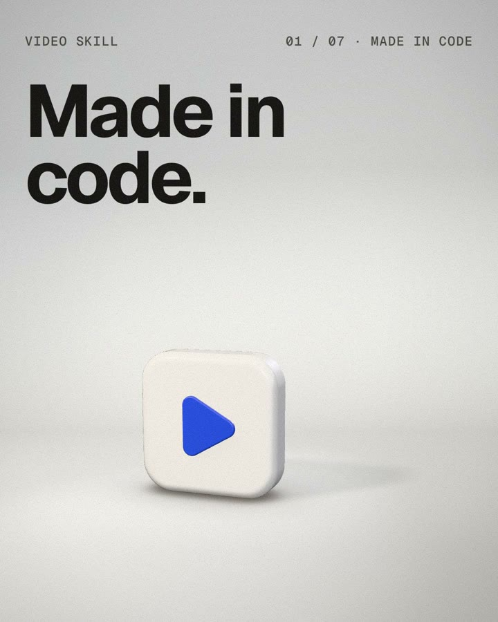
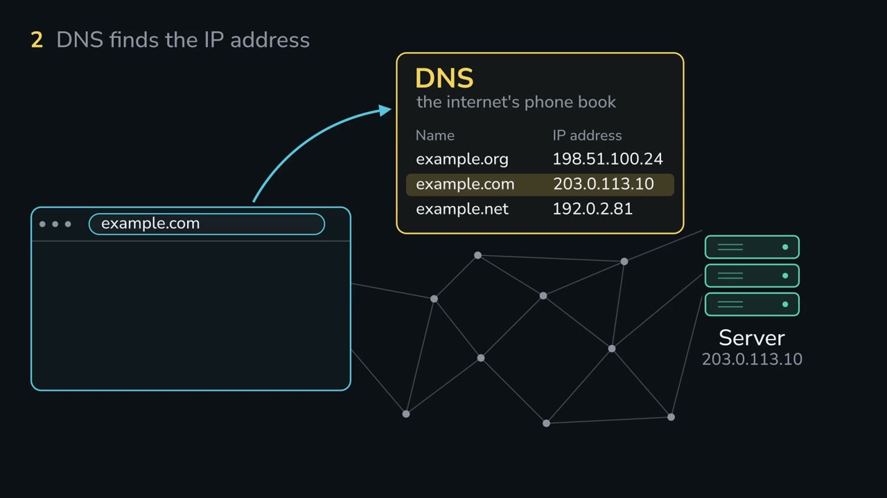
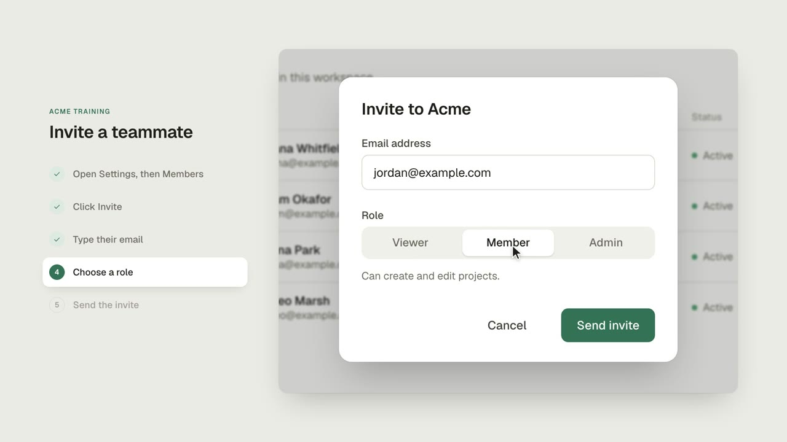
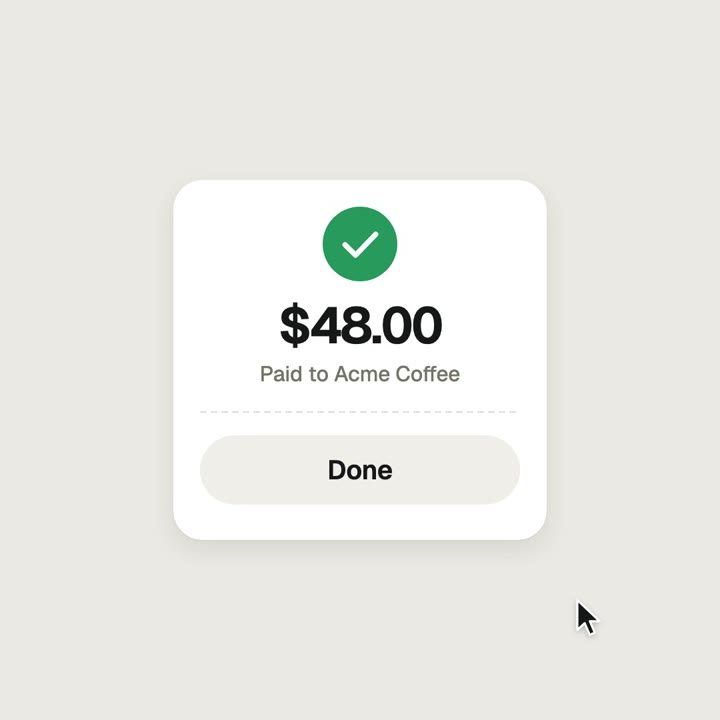

# video skill

**Make narrated explainers, app walkthroughs, training videos and motion loops entirely in code, with your coding agent.**

<a href="https://tstout729.github.io/video-skill/"></a>

*[Watch the skill in one minute](https://tstout729.github.io/video-skill/) in your browser, with the examples. It was made with this skill; its brief, scenes and review log are in [`one-minute/`](one-minute/). The first 74-second demo is in [`demo/`](demo/).*

You ask for a video. Your agent writes the script, records the voice, animates every frame in code in time with the narrator, checks its own pacing, and hands you an MP4 with captions. There's no video editor, timeline or After Effects.

It works in [Claude Code](https://claude.com/claude-code), [Codex](https://openai.com/codex) and any agent that supports [Agent Skills](https://agentskills.io).

**[Motion Lab, explained](https://tstout729.github.io/video-skill/#motion-lab)** is a 5½-minute film made with this skill. It explains Florence's article on directing AI motion with numbers. Its [brief](motion-lab/brief.md), [scenes](motion-lab/scenes/) and [review log](motion-lab/log.md) are all here: 62 review rounds, 107 notes pinned to frames, and 203 automated checks.

## What it makes

| | Kind | Good for | Built with |
| --- | --- | --- | --- |
| <a href="https://tstout729.github.io/video-skill/#explainer"></a> | **Explainer** | How a system, process or idea works: narrated, animated diagrams | [Manim](https://www.manim.community) |
| <a href="https://tstout729.github.io/video-skill/#walkthrough"></a> | **Walkthrough** | Product demos, feature tours, training and onboarding: a real screen used step by step, with a pointer that clicks as the narrator speaks | HTML + springs, rendered by [Playwright](https://playwright.dev) |
| <a href="https://tstout729.github.io/video-skill/#loop"></a> | **Loop** | Social posts and feature teasers: one shape morphing through UI states, timed to a beat | HTML + springs |

Every video gets:

- **A real voice** from [ElevenLabs](https://elevenlabs.io). Each take is transcribed and re-recorded if a phrase was dropped or repeated. For drafts, your computer's own voice works too, for free.
- **Word-level timing.** Each motion starts as the narrator says its cue words.
- **Captions** as a soft track and a `.srt` file, in any language.
- **Unhurried motion.** The agent follows the classic principles of animation, then checks its own work. It looks at every frame and measures every pause, so nothing changes before you can read it.

## Install

**Claude Code**, as a plugin:

```
/plugin marketplace add tstout729/video-skill
/plugin install video-skill@video-skill
```

**Any agent** (Claude Code, Codex, Cursor, Copilot and [many more](https://github.com/vercel-labs/skills)), with the skills CLI:

```sh
npx skills add tstout729/video-skill -g
```

**By hand**: copy or link the `skills/video` folder into your agent's skills folder. For example, use `~/.claude/skills/video` for Claude Code or `~/.codex/skills/video` for Codex.

```sh
git clone https://github.com/tstout729/video-skill
ln -s "$PWD/video-skill/skills/video" ~/.claude/skills/video
```

### Set up once

Ask your agent to *"set up the video skill"*, or run the setup script yourself:

```sh
bash skills/video/scripts/setup.sh      # from the repo, or the installed skill folder
```

It installs Playwright and Chromium into a private cache folder, never into your project. It also checks everything else:

| Needs | Why | Get it |
| --- | --- | --- |
| macOS or Linux | Windows works through WSL2 | |
| [ffmpeg](https://ffmpeg.org) | encoding, mixing, captions | `brew install ffmpeg` / `apt install ffmpeg` |
| [Node.js](https://nodejs.org) 18+ | the HTML renderer | `brew install node` |
| [uv](https://docs.astral.sh/uv/) | runs the Python scripts and Manim with their dependencies | `curl -LsSf https://astral.sh/uv/install.sh \| sh` |
| An [ElevenLabs](https://elevenlabs.io) API key | the finished narration (drafts, loops and the bundled examples don't need it) | `export ELEVENLABS_API_KEY=...` |

## Use it

Just ask:

- *"Make a 2-minute explainer of how our billing pipeline works."*
- *"Make a walkthrough video of the signup flow in this app, for new users."*
- *"Make a training video that shows how to approve a refund in our admin panel."*
- *"Make a 12-second square loop of our checkout button for LinkedIn."*
- *"Now make the same video in Spanish."*

The agent reads your code or docs for the facts, shows you its plan when the request is open-ended, then works through script, voice, animation, review and render. Each video lives in its own folder (`videos/<name>/` by default), so you can ask for changes later: *"slow down scene 3"*, *"use a calmer voice"*, *"fix the price on the second card"*.

## Try it without an API key

The examples include their recorded narration, so they render without an ElevenLabs key:

```sh
git clone https://github.com/tstout729/video-skill && cd video-skill
bash skills/video/scripts/setup.sh
bash tests/render-examples.sh            # renders every example at draft quality
```

Each example's README has the full-quality commands: [explainer](skills/video/examples/explainer/), [walkthrough](skills/video/examples/walkthrough/), [loop](skills/video/examples/loop/), [transitions](skills/video/examples/transitions/). They're also the templates your agent copies from.

Your own videos work without a key too. Ask for a draft with the scratch voice, or run `narrate.py --scratch`. Your computer's built-in voice (`say` on macOS, espeak-ng on Linux) reads the script, and the skill writes the same audio files and word timings a real take has. Timing, rendering, captions and mixing all work unchanged. That helps in two ways:

- **Iterate on timing for free.** Rework the script and the animation against the scratch voice as often as you like. Record the real voice once, when both are settled.
- **Make a full draft without a key.** Anyone can go from a request to a narrated MP4 with captions before signing up for ElevenLabs. Lists that test skills on machines with no voice keys, such as [awesome-claude-video-skills](https://github.com/zhuyansen/awesome-claude-video-skills), get the whole pipeline, not just the silent parts.

Word times come from a forced alignment of the scratch take, so cues land within a frame or two of the words. The final mix prints a large warning while any scratch take is still in the video, and running `narrate.py` with a key replaces them all. Details: [Scratch voice](skills/video/references/scratch-voice.md).

## Tips

- **Direct, don't describe.** Give the agent numbers, not adjectives: "springs at damping 0.8, entrances 400 ms ease-out, one push-in at 3 s" instead of "make it premium". The skill writes a `brief.md` like this for every video, from [a template](skills/video/references/brief.md).
- **Count your rounds.** A finished piece usually takes 2–4 review rounds. Each video's `log.md` records them, with notes tied to frame numbers. Post the log alongside the video: receipts build trust.
- **Effort.** Run your agent at its default effort. Raise it only when a piece built from scratch misses twice.
- **Windows.** Use WSL2. Native PowerShell 5 does not support `&&`, and `npx` may need to be `npx.cmd`.
- **No install?** The brief template and the [numbers](skills/video/animation-principles.md) work in any chat. Paste them into the Claude app with your request, and give your fixes as frame numbers. You'll have to screen-record the result yourself, which drops frames, so install the skill for real exports.

## Your preferences

Put your defaults in `~/.config/video-skill/preferences.md`, or in `VIDEO.md` in a project; the project file wins. Write them in plain words. For example:

```markdown
- Use the voice "Alice" (Xb7hH8MSUJpSbSDYk0k2). Spanish versions use voice ...
- Save finished videos to ~/Movies/Videos/.
- Brand: background #0F172A, accent #22C55E, font Inter.
- At the end of a big feature, make a short explainer of what changed.
```

## Costs

Rendering is local and free, and so are drafts read by the scratch voice. Narration uses ElevenLabs credits: about 1,000 characters of script per minute of video, plus one short transcription per take to check it. Only changed scenes are re-recorded. The agent tells you before it records.

## How it works

```
narration.json ─▶ narrate.py ─▶ audio + word timings
                                   │
              ┌────────────────────┴────────────────────┐
         video.py (Manim)                       index.html (seek(t) page)
              │                                          │
         manim render                    render.mjs: Playwright frames + motion blur
              │                                          │
         assemble.py ──────▶  MP4 + captions  ◀────── mux.py (voice, UI sounds, music)
```

- **Explainers** use [Manim](https://www.manim.community) with a small base class. `self.play_at("cue words", ...)` starts an animation as the narrator says those words.
- **Walkthroughs and loops** are one HTML page that draws each frame as a pure function of time. Springs are closed-form, so a frame never depends on the one before it, and rendering runs in parallel. The renderer blends subframes for motion blur, and `mux.py` places every UI sound on its moment.
- **Pacing** follows [`animation-principles.md`](skills/video/animation-principles.md). It turns the classic principles of animation into rules for UI and diagram motion: one change at a time, holds long enough to read, anticipation, arcs, slow in and out. It ends with a hold check the agent runs on its own render.

## Credits

- The directed brief, the numbers, the render contract and the review loop build on Florence's X Article [*Opus 5.5 Motion Lab: Make Claude Animate Like a Studio*](https://x.com/flxrnc/status/2105311836190978392) (@flxrnc, September 30, 2026).
- The principles of animation come from Disney's animators. John Lasseter applied them to computer animation in [*Principles of Traditional Animation Applied to 3D Computer Animation*](https://dl.acm.org/doi/10.1145/37402.37407) (SIGGRAPH 1987).
- The transitions in `transitions.js` build on ideas from [AbubakrChan/product-launch-motion](https://github.com/AbubakrChan/product-launch-motion) (MIT; the zoom-through and the film grade), [haidrrrry/claude-remotion-skill](https://github.com/haidrrrry/claude-remotion-skill) (MIT; the whip) and [cth9191/animate](https://github.com/cth9191/animate) (MIT; the morph bridge). The cut check in `review.mjs cuts` follows the seam check in [heygen-com/hyperframes](https://github.com/heygen-com/hyperframes) (Apache-2.0). No code was copied.
- The explainer style is inspired by [3Blue1Brown](https://www.3blue1brown.com) and built on [Manim Community](https://www.manim.community).
- The UI motion approach was adapted from Ross's open motion-design prompt template ([@rossaxbt](https://x.com/rossaxbt)).
- The numbered storyboard and the checks for cut-off and overlapping text follow ideas from [cth9191/animate](https://github.com/cth9191/animate) (MIT). Measuring contrast against the real pixels behind hidden text follows the contrast report in [heygen-com/hyperframes](https://github.com/heygen-com/hyperframes) (Apache-2.0). The code in `review.mjs` is new.
- The riso, pixel-art and cut-paper style packs follow the style kits of [cth9191/animate](https://github.com/cth9191/animate) (MIT, © 2026 cth9191). The pixel font is ported from it; its notice is in [`skills/video/runtime/styles/NOTICE`](skills/video/runtime/styles/NOTICE).
- The fonts are [Geist and Geist Mono](https://vercel.com/font), [Nunito Sans](https://fonts.google.com/specimen/Nunito+Sans) and the Greek subset of [Inter](https://rsms.me/inter/), all under the SIL Open Font License.
- The tools: [Playwright](https://playwright.dev), [ffmpeg](https://ffmpeg.org), [ElevenLabs](https://elevenlabs.io) and [uv](https://docs.astral.sh/uv/). Scratch voices come from macOS `say` and [eSpeak NG](https://github.com/espeak-ng/espeak-ng), run as installed programs, never bundled.

## License

[MIT](LICENSE). The bundled fonts keep their own licenses.
